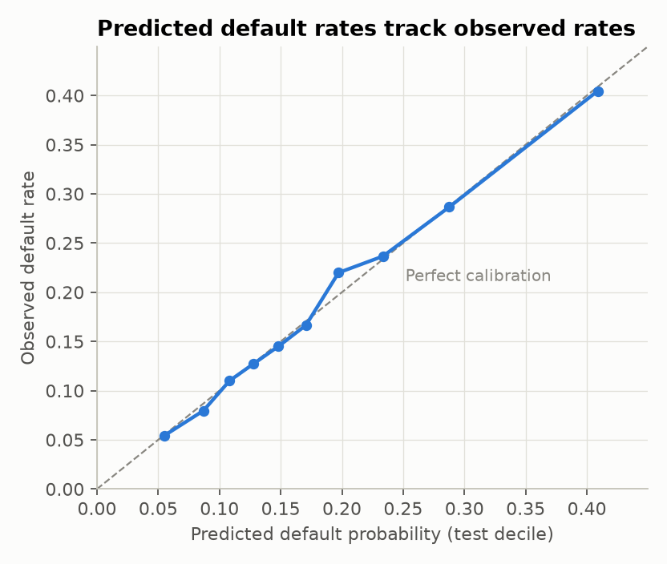
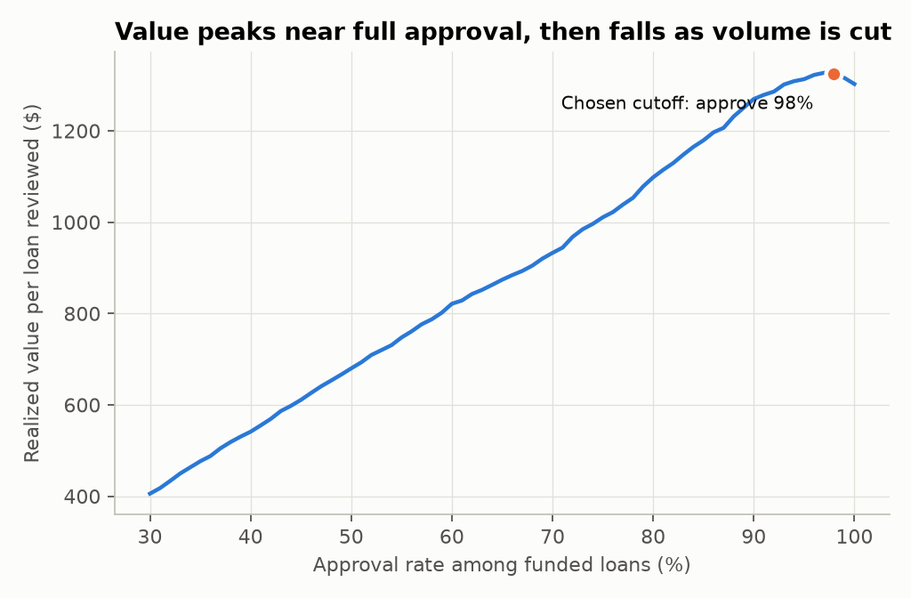

# Credit Default Risk Model

An end-to-end consumer credit model on 163,987 real LendingClub loans: training, calibration, a lending policy, adverse-action reasons, a scoring API that records every decision in PostgreSQL, drift monitoring, and deployment on AWS (S3, RDS, Elastic Beanstalk).

**Main result:** using only application data, the model ranks default risk better than LendingClub's own interest rate does (AUC 0.688 vs. 0.672; difference +0.016, 95% CI +0.009 to +0.024). Its predicted default rates also match observed rates to within about half a percentage point on held-out loans.

## Results

All figures are from a 20% test set (32,798 loans) used only for final evaluation.

| Model | AUC | KS | Brier |
|---|---:|---:|---:|
| LendingClub's interest rate (benchmark) | 0.672 | | |
| Logistic regression | 0.681 | 0.265 | 0.1398 |
| **LightGBM with monotone constraints (chosen)** | **0.688** | **0.278** | **0.1390** |
| LightGBM, unconstrained | 0.691 | 0.282 | 0.1388 |

**Why I chose a slightly less accurate model.** The unconstrained model has 0.003 more AUC, but it can learn that a higher income raises risk in some range. That can't be explained to a declined applicant. Monotone constraints rule it out, and tests confirm they hold.

An AUC near 0.69 is modest. This data has no credit bureau score, and every loan had already passed LendingClub's screening, which removes much of the signal.



## What I found beyond the headline

- **Ranking held up under a population shift, but calibration didn't.** When I trained on the first 80% of the file and tested on the last 20%, AUC only fell to 0.679. But predicted default was 19.2% against 15.8% observed. A model in production can keep ranking well while its probabilities go stale, so calibration needs its own monitoring. The file has no dates, so this is a stress test and not a true out-of-time test.
- **The model adds less as a cutoff than as a ranking.** Because these loans were already screened and priced, the value-maximizing cutoff approves 97.9% of them and lowers the bad rate only from 18.3% to 17.6%.
- **That policy depends on an assumption I can't measure.** Value per loan rises $23 at a 65% loss given default and $51 at 80%, but falls $5 at 50%. The data doesn't contain recoveries, so I report the range and not one number.
- **Drift monitoring separates normal from abnormal.** Score PSI is 0.0002 on a random holdout and 0.29 on a simulated downturn (income down 20%, DTI up 5 points, revolving utilization up 10 points), which crosses the 0.25 action level.



## Decisions worth discussing

| Decision | Reason |
|---|---|
| Left out `int_rate` | It's LendingClub's own risk price, so including it would measure their model and not this one. I use it as the benchmark instead. |
| Left out `addr_state` | Geography can stand in for protected classes. |
| Separate splits for early stopping, calibration and cutoff, and testing | Stops any of those choices from flattering the final numbers. |
| Tested isotonic calibration, then dropped it | It didn't improve held-out calibration, so it would only add complexity. |
| Paired bootstrap for model comparisons | Both models are scored on the same resampled loans, which gives a direct CI on the difference. |
| Reasons from SHAP values | Only risk-increasing factors are shown, in the plain style of Regulation B's sample notices. |

## Recording decisions in SQL

Every scored application is saved to a database: PostgreSQL in production, or a local SQLite file when `DATABASE_URL` isn't set. There are two tables:
- `scored_applications`: the inputs, the predicted default probability, the decision, and the model version
- `decline_reasons`: one row per reason, so reasons can be counted with `GROUP BY` instead of parsing text

Two reports run as SQL on either database:

| Endpoint | What it shows |
|---|---|
| `GET /reports/daily?days=30` | Applications, approval rate, and average predicted default by day, plus a rolling approval rate (window function) |
| `GET /reports/decline-reasons?days=30` | How often each reason appears among declines |

**If the database is down, the API refuses to decide (HTTP 503).** A lending decision with no record can't be audited or explained to the applicant later, and Regulation B requires lenders to keep application records for 25 months. So a missing record is treated as a failure, not a warning.

The drift monitor can read straight from this table (`python src/monitor.py --db`), so it checks the applicants the API actually saw.

## Running on AWS

The model is stored in **S3** under a versioned name, decisions go to **RDS for PostgreSQL**, and the API runs on **Elastic Beanstalk**. Step-by-step setup is in [DEPLOY.md](DEPLOY.md).

## Limitations

- **Selection bias:** only funded loans have outcomes. Performance on the applicants LendingClub declined is unknown, so a real policy change would need reject inference or a controlled test.
- **No fair-lending test here:** this dataset has no protected-class fields. A companion mortgage fairness audit covers that using different data.
- **Simplified economics:** the value calculation ignores funding costs, servicing costs, and interest collected before default.
- **Not legal advice:** the reason text illustrates the approach and hasn't had compliance review.
- **Old data:** the loans date from LendingClub's earlier years, so this is a demonstration of method and isn't suited to current underwriting.

## Run it

Requires Python 3.11. Run these from this folder:

```bash
pip install -r requirements.txt
```

```bash
python src/download_data.py
```

```bash
python src/train.py
```

```bash
python -m pytest
```

```bash
uvicorn --app-dir src api:app --port 8000
```

Then score an application:

```bash
curl -X POST http://127.0.0.1:8000/score -H "Content-Type: application/json" -d "{\"loan_amnt\":35000,\"term\":\"60 months\",\"annual_inc\":30000,\"dti\":38,\"home_ownership\":\"RENT\",\"purpose\":\"small_business\",\"verification_status\":\"verified\",\"emp_length\":0,\"delinq_2yrs\":4,\"revol_util\":98,\"total_acc\":6,\"longest_credit_length\":2}"
```

The response gives the default probability (0.87 here), the decision, and the reasons:

```json
{"probability_of_default": 0.8698, "decision": "decline", "cutoff": 0.4587,
 "adverse_action_reasons": ["Purpose of the loan", "Amount requested is high relative to income",
 "Requested repayment term", "Proportion of revolving balances to credit limits is too high"],
 "model_version": "1.0.0"}
```

The response also includes an `application_id`, the row where the decision was saved. Open `http://127.0.0.1:8000/docs` to try the API in a browser.

Check recent applications for drift, from a CSV or straight from the database. The command exits with status 2 when action is needed, so a scheduler can alert on it:

```bash
python src/monitor.py path/to/applications.csv
```

```bash
python src/monitor.py --db --days 30
```

To also run the database tests against PostgreSQL, set `TEST_POSTGRES_URL` to a PostgreSQL connection string before running `pytest`.

## Layout

```
src/features.py      Shared feature code for training and serving, which prevents skew
src/metrics.py       AUC CIs, KS, calibration error, PSI
src/train.py         Training, comparison, policy analysis, drift, and charts
src/scoring.py       Scoring and adverse-action reasons
src/api.py           FastAPI service with input validation and SQL reports
src/db.py            Database tables, decision logging, and report queries
src/model_store.py   Loads the model from S3 or a local file
src/upload_model.py  Uploads a trained model to S3 under a versioned name
src/monitor.py       Drift report from a CSV or the database
tests/               33 tests: model, API, SQL (SQLite and PostgreSQL), and S3
Procfile, .ebextensions/   Elastic Beanstalk settings
DEPLOY.md            Step-by-step AWS setup
reports/             metrics.json and charts
```

**Data:** LendingClub public loan data, via [H2O.ai's cleaned extract](https://github.com/h2oai/app-consumer-loan).
